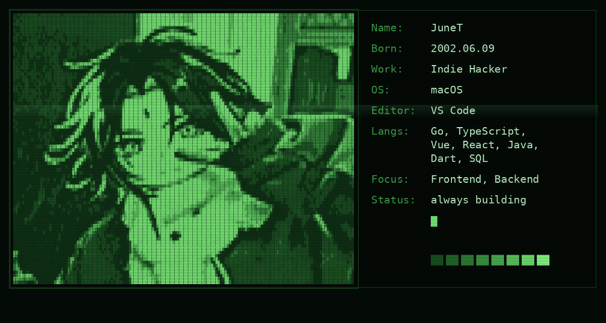

<div align="center">



<p>
  <sub>
    <code>$ whoami</code> → building small, sharp things for the web.
  </sub>
</p>

<p>
  
  
  
</p>

</div>

---

### `~/stack`

```console
june@dev ~ % cat stack.txt
```

| area | tools |
| :--- | :--- |
| **Languages** | `Go` `TypeScript` `Java` `Dart` `SQL` `Bash` |
| **Backend** | Gin · Hono · Cloudflare Workers · SQLite |
| **Frontend** | Vue 3 · React · Vite · Tailwind |
| **Mobile** | Flutter |
| **Infra** | Docker · GitHub Actions · Cloudflare Tunnel · OCI · systemd |

---

### `~/work`

<table>
<tr>
<td width="50%" valign="top">

**🧩 [Imgbed](https://github.com/CheeseTJ/Imgbed-api)**
Self-hosted image bed — Go API + Vue console, R2 storage.

**📚 [JMReader](https://github.com/CheeseTJ/JMReader-web)**
Reader frontend on Vue 3, paired with a Go backend.

**🎵 [Music](https://github.com/CheeseTJ/Music-api)**
Unified music API (search / url / lyrics / rank) on Hono.

</td>
<td width="50%" valign="top">

**⏰ [Remind](https://github.com/CheeseTJ/Remind)**
Lunar + solar reminders in a single Go binary.

**🗣️ [WordRush](https://github.com/CheeseTJ/WordRush-web)**
Vocabulary PWA with speech assessment + chat.

**⚙️ [CICD](https://github.com/CheeseTJ/CICD)**
Release distribution to Pgyer, with Actions monitoring.

</td>
</tr>
</table>

---

### `~/contact`

```console
june@dev ~ % ./contact --list
github  : github.com/CheeseTJ
hosting : self-hosted, behind a Cloudflare tunnel
status  : always building something
```

<div align="center">
  <sub>
    If you find my work useful, a ⭐ on any repo goes a long way.
  </sub>
</div>
